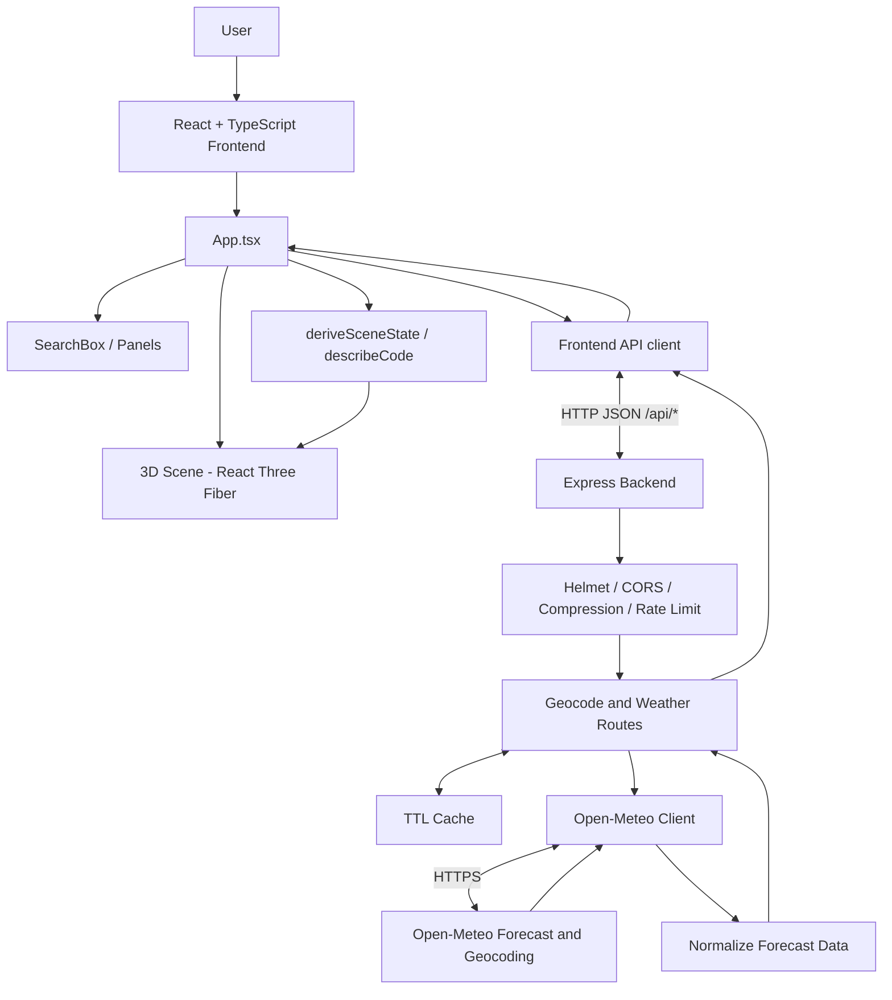
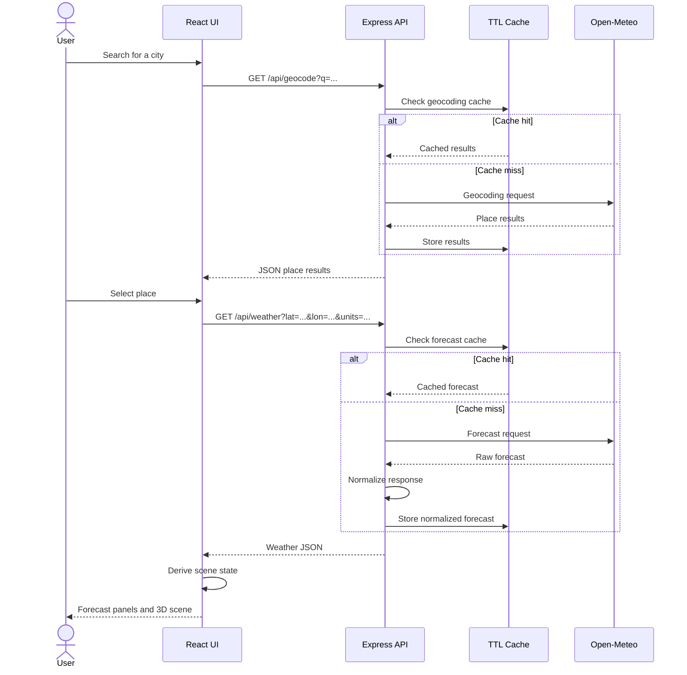
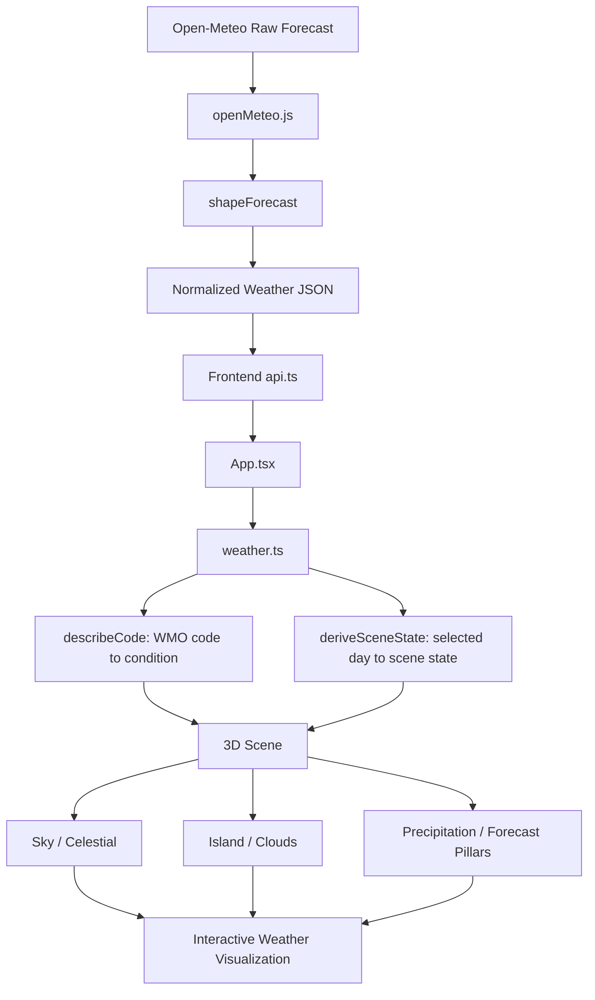
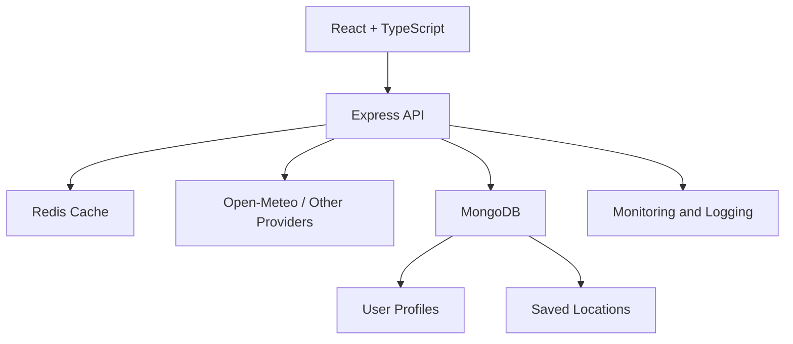

# Weather Atlas — Reverse Engineering Project

<p align="center">
  <strong>An interactive 3D weather application powered by React, Three.js, Express and Open-Meteo.</strong>
</p>

<p align="center">
  <a href="https://github.com/ramkrishna656/Weather-reverse">Repository</a> ·
  <a href="https://open-meteo.com/en/docs">Weather API</a> ·
  <a href="https://github.com/morluto/rea">REA Toolkit</a>
</p>

## 1. Project Overview

**Weather Atlas** is an interactive weather application that presents current conditions and forecasts through a 3D floating-island environment. The sky, clouds, lighting, wind and precipitation are driven by weather data retrieved from Open-Meteo. Seven pillars arranged around the island represent the seven-day forecast; selecting a pillar updates the scene for that day.

This repository also documents a reverse-engineering study workflow. REA (Reverse Engineering Agents) may be used to investigate a permitted reference application, extract functional and design requirements, and inform implementation decisions. **REA is an optional analysis tool; it is not part of the Weather Atlas runtime or weather-data pipeline.**

### Project objectives

- Search for places and retrieve their geographic coordinates.
- Display current weather conditions.
- Present the next 24 hours and seven-day forecast.
- Translate weather conditions into an interactive 3D scene.
- Allow users to switch between metric and imperial units.
- Provide browser geolocation support.
- Apply server-side validation, caching, rate limiting and error handling.
- Document a reproducible reverse-engineering and verification workflow.

## 2. Technology Stack

| Layer | Technology | Purpose |
|---|---|---|
| Frontend | React 18 | User interface |
| Build tool | Vite | Development server and production build |
| Language | TypeScript | Frontend types and application logic |
| 3D engine | Three.js | 3D rendering |
| React 3D integration | React Three Fiber | React-based Three.js scene |
| 3D utilities | Drei | Scene helpers and controls |
| Runtime | Node.js 20+ | JavaScript server runtime |
| Backend | Express 4 | REST API and static hosting |
| Weather provider | Open-Meteo | Forecast and geocoding data |
| Security | Helmet, CORS | HTTP security headers and cross-origin policy |
| Performance | compression | HTTP response compression |
| Rate limiting | express-rate-limit | API request throttling |
| Cache | Custom in-memory TTL cache | Reuse upstream results |
| Tests | Node.js test runner | Backend verification |
| Reverse engineering | REA | Optional reference-application analysis |

## 3. Repository Structure

The application lives inside `weather-atlas/`.

```text
Weather-reverse/
└── weather-atlas/
    ├── client/
    │   ├── index.html
    │   ├── package.json
    │   ├── tsconfig.json
    │   ├── vite.config.ts
    │   └── src/
    │       ├── main.tsx
    │       ├── App.tsx
    │       ├── styles.css
    │       ├── components/
    │       │   ├── Panels.tsx
    │       │   ├── SearchBox.tsx
    │       │   └── scene/
    │       │       ├── Scene.tsx
    │       │       ├── Island.tsx
    │       │       ├── Clouds.tsx
    │       │       ├── Sky.tsx
    │       │       ├── Precipitation.tsx
    │       │       └── Pillars.tsx
    │       └── lib/
    │           ├── api.ts
    │           ├── weather.ts
    │           └── webgl.ts
    ├── server/
    │   ├── package.json
    │   ├── src/
    │   │   ├── index.js
    │   │   ├── app.js
    │   │   ├── openMeteo.js
    │   │   ├── cache.js
    │   │   └── env.js
    │   └── test/
    │       └── api.test.js
    ├── .env.example
    ├── .gitignore
    ├── package.json
    ├── package-lock.json
    └── README.md
```

### Frontend modules

| File | Responsibility |
|---|---|
| `App.tsx` | Coordinates application state, place, units, API loading, errors, selected day and scene state. |
| `SearchBox.tsx` | City search and location selection UI. |
| `Panels.tsx` | Current, hourly and selected-day forecast panels. |
| `scene/Scene.tsx` | Composes the Three.js scene, camera controls and scene components. |
| `scene/Island.tsx` | Floating-island model and environment. |
| `scene/Clouds.tsx` | Cloud visualization. |
| `scene/Sky.tsx` | Sky lighting and celestial objects. |
| `scene/Precipitation.tsx` | Precipitation effects. |
| `scene/Pillars.tsx` | Seven-day forecast pillars and selection. |
| `lib/api.ts` | API functions and shared TypeScript data types. |
| `lib/weather.ts` | WMO weather-code interpretation and scene-state derivation. |
| `lib/webgl.ts` | WebGL capability detection. |

### Backend modules

| File | Responsibility |
|---|---|
| `src/index.js` | Loads environment configuration and starts the HTTP server. |
| `src/app.js` | Express app, middleware, routes, validation, caches, static serving and error handling. |
| `src/openMeteo.js` | Open-Meteo HTTP requests, timeout/error mapping and response normalization. |
| `src/cache.js` | In-memory time-to-live cache with a 500-entry cap. |
| `src/env.js` | Attempts to load supported local `.env` files. |
| `test/api.test.js` | Tests forecast shaping, validation, caching and upstream error handling. |

## 4. System Architecture

The browser communicates with the Express backend through JSON REST endpoints. The backend validates requests, checks its cache and, on a cache miss, calls Open-Meteo. The frontend derives a scene state from the normalized response and passes it to the 3D components.



### Main runtime sequence



## 5. Reverse-Engineering Methodology (REA)

Reverse engineering is the systematic investigation of an existing system to understand its observable behaviour, structure and design decisions. In this project, the workflow can be used to study a weather application that you are authorized to inspect and translate the findings into requirements for Weather Atlas.

**REA is not used to fetch weather data, render the 3D scene or serve the application.** The implementation is built with the technologies described above.

### Analysis phases

1. **Select a reference application.** Choose a weather application or website that you have permission to inspect. Define the features and scope to study.
2. **Set up REA.** Follow REA's official setup guide and register its agent/MCP integration with your supported agent environment.
3. **Inspect the reference.** Use REA's supported analysis capabilities to investigate relevant application structure and behaviour. Record evidence and distinguish observed facts from assumptions.
4. **Extract requirements.** Document location search, forecast presentation, weather states, interactions, responsive behaviour and visual transitions.
5. **Map requirements to modules.** Relate the requirements to the Weather Atlas components, API routes, data model and 3D scene.
6. **Implement and verify.** Use the existing application, run its tests and compare actual behaviour with the documented requirements.

### REA commands

The project's original application README documents the following example commands:

```bash
# Set up/register REA with the supported agent environment
npx -y rea-agents@latest setup

# Analyze a permitted extracted JavaScript application
npx -y rea-agents@latest analyze-javascript-application /path/to/extracted/app --json
```

Replace `/path/to/extracted/app` with the actual path to an application you are authorized to analyze. Check the [REA repository](https://github.com/morluto/rea) for current prerequisites, supported environments and command options.

### REA analysis deliverables

- Reference application and analysis scope.
- Screenshots or observations of relevant user flows.
- Component and interaction inventory.
- Extracted functional and non-functional requirements.
- Mapping from requirements to Weather Atlas modules.
- Verification notes showing which observations were reproduced.

## 6. Weather Data Processing and 3D Visualization

Open-Meteo returns current, hourly and daily weather fields. The backend's `shapeForecast()` function transforms the provider response into the compact JSON contract expected by the frontend.

The `weather.ts` module interprets WMO weather codes and derives scene parameters such as condition type, precipitation intensity, cloud cover, day/night state, sun/moon arc and wind.



### Supported condition categories

| Category | Meaning |
|---|---|
| Clear | Clear or mostly clear sky |
| Cloud | Partly cloudy or overcast |
| Fog | Fog or depositing rime fog |
| Rain | Drizzle, rain or showers |
| Snow | Snow or snow showers |
| Storm | Thunderstorm, including hail codes |

### Seven-day forecast interaction

1. Backend requests a seven-day forecast.
2. The response is transformed into daily row objects.
3. The frontend receives the normalized forecast.
4. `Pillars.tsx` renders the forecast pillars.
5. The user selects a day.
6. `App.tsx` updates the selected-day state.
7. `deriveSceneState()` calculates parameters for that day.
8. The scene components update to reflect the selected forecast.

## 7. API Documentation

The Express application exposes these endpoints:

| Method | Endpoint | Description |
|---|---|---|
| GET | `/api/health` | Liveness check. |
| GET | `/api/geocode?q=<place>` | Search for a place; query length must be 2–80 characters. |
| GET | `/api/weather?lat=<lat>&lon=<lon>&units=metric` | Get current, next-24-hour and seven-day weather. |
 
### Health check

```http
GET /api/health
```

Returns an `ok` flag and server timestamp.

### Geocoding

```http
GET /api/geocode?q=Kolkata
```

Returns a `results` array containing matching places and their coordinates. The actual response depends on Open-Meteo.

### Weather forecast

```http
GET /api/weather?lat=22.57&lon=88.36&units=metric
```

The response has the following top-level structure:

```json
{
  "location": {},
  "units": {},
  "current": {},
  "hourly": [],
  "daily": []
}
```

- `location`: coordinates, elevation and timezone metadata.
- `units`: measurement system and display units.
- `current`: current conditions, including temperature, humidity, wind and pressure.
- `hourly`: up to the next 24 hours.
- `daily`: seven-day forecast values.

Coordinates must be valid: latitude from -90 to 90 and longitude from -180 to 180. Units are `metric` or `imperial`; other values default to metric.

## 8. Caching and Storage

The application does not currently use MongoDB, MySQL or another persistent database.

| Mechanism | Data | Lifetime |
|---|---|---|
| Browser local storage | Selected place and units | Until browser storage is cleared or changed |
| Geocoding TTL cache | Location search results | 1 hour |
| Forecast TTL cache | Normalized forecast responses | 10 minutes |

The in-memory `TtlCache` has a maximum of 500 entries and evicts the oldest entry when the capacity is reached. Forecast cache keys use coordinates rounded to 0.01 degrees and the selected unit system.

**Limitations:** in-memory cache entries are lost when the server restarts and are not shared between multiple application instances.

## 9. Security and Performance

The existing backend includes:

- Helmet for HTTP security headers.
- Configurable CORS.
- Compression middleware.
- API rate limit of 120 requests per 60 seconds.
- Validation of geocoding queries and weather coordinates.
- Eight-second timeout for upstream Open-Meteo requests.
- Mapping of upstream errors to HTTP error responses.
- Cache-Control response header for forecast responses.
- Production static hosting of the built frontend when `client/dist` exists.

The frontend uses abortable weather requests, checks WebGL availability and provides a text-based forecast fallback when WebGL is unavailable. The scene respects the user's reduced-motion preference.

## 10. Installation and Setup

### Requirements

- Node.js 20 or newer.
- npm.
- Internet access for Open-Meteo requests.

### Development

Run these commands from the application directory:

```bash
cd weather-atlas
npm install
```

Create a local environment file:

```bash
cp .env.example .env
```

Start both development processes:

```bash
npm run dev
```

| Service | Default address |
|---|---|
| Vite frontend | http://localhost:5173 |
| Express API | http://localhost:4000 |

Vite proxies `/api` requests to the Express server. The root package uses concurrently to start the client and server together.

### Production

```bash
npm run build
npm start
```

The build command type-checks and builds the frontend into `client/dist`. The Express server serves the built frontend and API on port 4000 by default.

## 11. Environment Variables

Copy `.env.example` to `.env`.

| Variable | Purpose | Default / behaviour |
|---|---|---|
| `PORT` | Express port | `4000` |
| `OPEN_METEO_API_KEY` | Optional commercial API key | Empty for the free tier |
| `CORS_ORIGIN` | Comma-separated allowed origins | Any origin if unset |
| `OPEN_METEO_FORECAST_URL` | Optional forecast endpoint override | Selected automatically |
| `OPEN_METEO_GEOCODE_URL` | Optional geocoding endpoint override | Selected automatically |
| `API_URL` | Vite development proxy target | `http://localhost:4000` |

Do not commit secrets or a real `.env` file. The Open-Meteo free tier is subject to its terms and non-commercial-use conditions; review the provider's current terms before commercial deployment.

## 12. Testing and Verification

Run the available checks from `weather-atlas/`:

```bash
# Backend automated tests
npm test

# Type-check server and client
npm run typecheck

# Build frontend (includes TypeScript check)
npm run build
```

The existing backend test suite covers:

- Transformation of provider column arrays into normalized forecast rows.
- Selection of the next 24 hourly values.
- Metric and imperial unit output.
- Validation of invalid coordinates.
- Forecast caching for rounded coordinates and unit system.
- Geocoding query validation and results.
- Mapping of upstream timeout errors.

### Suggested manual acceptance tests

| ID | Test | Expected result |
|---|---|---|
| TC-01 | Open application | Main weather interface loads. |
| TC-02 | Search for a city | Matching place results appear. |
| TC-03 | Select a place | Weather data updates. |
| TC-04 | Use current location | Browser requests geolocation permission. |
| TC-05 | Switch units | Values use the selected measurement system. |
| TC-06 | Select a forecast pillar | Selected day information and scene update. |
| TC-07 | Drag scene | Camera orbits around the island. |
| TC-08 | Disable WebGL | Forecast remains available without the 3D view. |
| TC-09 | Submit invalid coordinates | API returns HTTP 400. |
| TC-10 | Repeat identical forecast request | Cache avoids an additional upstream call while valid. |
| TC-11 | Simulate upstream timeout | API returns a mapped upstream error. |
| TC-12 | Call health endpoint | API returns a successful health response. |

## 13. Current Limitations and Future Scope

These are potential improvements, not features currently implemented.

| Current state | Possible future enhancement |
|---|---|
| In-memory cache | Redis for shared/distributed caching |
| No account system | User registration and authentication |
| Selected location stored locally | Saved cities and favourites |
| No historical database | Historical weather analytics |
| Single configured provider | Additional weather-provider integration |
| No deployment workflow documented | CI/CD and automated deployment |
| 3D visualization depends on WebGL | More capable lightweight fallback |

### Possible extended architecture



This diagram is a proposed future architecture. Redis, MongoDB, user accounts and monitoring are not part of the current repository implementation.

## 14. Suggested College Presentation Sequence

1. Title: Weather Atlas — Reverse Engineering of an Interactive 3D Weather Application.
2. Introduction to software reverse engineering.
3. Problem statement and project objectives.
4. Technology stack.
5. REA setup and reference-application analysis.
6. Requirement extraction and module mapping.
7. System architecture and project structure.
8. API and weather-data flow.
9. 3D scene and seven-day forecast interaction.
10. Testing, limitations, conclusion and future scope.

### Suggested demo sequence

1. Start the application with `npm run dev`.
2. Open http://localhost:5173.
3. Show the default location and current weather.
4. Search for another city and select it.
5. Switch between °C and °F.
6. Demonstrate the hourly forecast.
7. Select different forecast pillars.
8. Rotate the 3D scene.
9. Show the health endpoint and automated tests.

## 15. Conclusion

Weather Atlas demonstrates how a weather application can combine API integration, frontend state management, data transformation and interactive 3D visualization. The reverse-engineering workflow provides a structured way to study a permitted reference application, extract requirements and map the findings to an implementation.

The current system uses React, TypeScript, Three.js, Express and Open-Meteo. Its backend includes validation, rate limiting, error handling and in-memory caching. The project can be extended with persistent storage, distributed caching, user accounts and deployment automation.

## 16. References

- [Weather Atlas repository](https://github.com/ramkrishna656/Weather-reverse)
- [REA — Reverse Engineering Agents](https://github.com/morluto/rea)
- [Open-Meteo API documentation](https://open-meteo.com/en/docs)
- [Open-Meteo Geocoding API](https://open-meteo.com/en/docs/geocoding-api)
- [React documentation](https://react.dev/)
- [Vite documentation](https://vite.dev/)
- [React Three Fiber documentation](https://r3f.docs.pmnd.rs/)
- [Three.js documentation](https://threejs.org/docs/)
- [Express documentation](https://expressjs.com/)

---

**Documentation note:** This README documents the inspected source structure and implemented behaviour. Proposed extensions and suggested manual test cases are explicitly identified as future work or recommendations.
